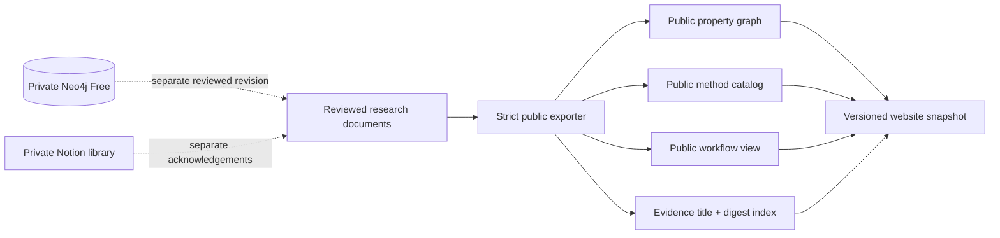

# Public documentary architecture

The website is a versioned, reviewed snapshot. Neo4j Free and Notion are separate private surfaces; neither is asserted to update this GitHub export automatically. There is no background or two-way synchronization.

## Property-graph contract

`project-graph.public.json` uses stable `nodes[].id` and `edges[].id`. Every edge names an existing `source`, `target`, and typed `relation`. `evidence_ids` join to `evidence-index.public.json`. A Neo4j importer can `MERGE` nodes by `id`, then relationships by `id`, while preserving the published `kind` and `relation` allowlists. The repository does not include database credentials or a cloud import command.

## Research boundary

The graph is navigation and documentation, not market evidence. Architecture v3 remains blocked on a qualified historical security master and 756 trustworthy point-in-time dates. Prospective collection does not repair historical identity, membership, or delisting gaps.
